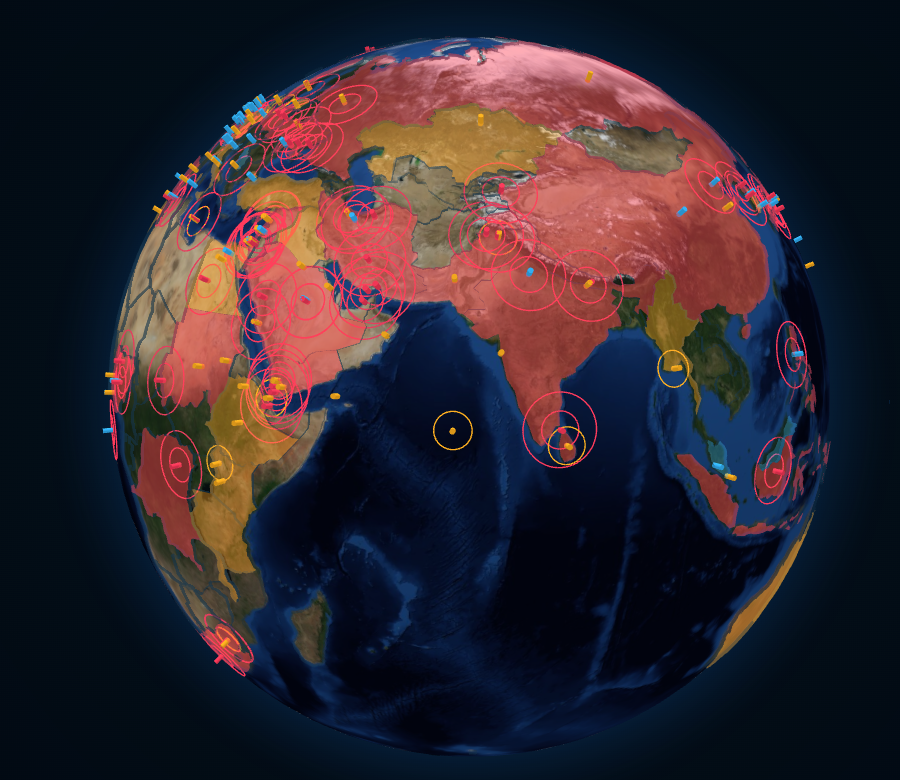

# Global Event Intelligence

An MVP AI-powered global news/event intelligence map.

## Architecture

News Sources (GDELT + RSS + Google News RSS)
        |
        v
FastAPI ingestion service
        |
        +--> normalization/deduplication
        |
        +--> optional Ollama AI analysis
        |
        v
SQLite database (easy local setup)
        |
        v
REST API
        |
        v
React + TypeScript globe/dashboard frontend

This MVP deliberately uses SQLite first so it can run without PostgreSQL.
The database layer can later be upgraded to PostgreSQL/PostGIS.

## Requirements

- Python 3.11+
- Node.js 22.22.2 or newer (matching the frontend engine requirement)
- npm
- Internet connection for GDELT/RSS/Google News RSS ingestion
- Optional: Ollama for local AI analysis

## 1. Backend

```bash
cd backend
python -m venv .venv
```

Windows PowerShell:
```powershell
.\.venv\Scripts\Activate.ps1
```

Windows CMD:
```cmd
.venv\Scripts\activate
```

Linux/macOS:
```bash
source .venv/bin/activate
```

Install:
```bash
pip install -r requirements.txt
```

Start:
```bash
uvicorn app.main:app --reload --port 8000
```

API:
- http://localhost:8000
- http://localhost:8000/docs
- http://localhost:8000/api/health

The API creates `backend/data/events.db` automatically.

API routes are organized by responsibility under `backend/app/api/`:

- `health.py` - health check
- `events.py` - event queries, details, and demo seed data
- `countries.py` - country events and intelligence
- `statistics.py` - global statistics
- `ingestion.py` - news ingestion
- `routes.py` - combines the API routers

## 2. Frontend

Open another terminal:

```bash
cd frontend
npm install
npm run dev
```

Open the Vite URL shown in the terminal, normally:
http://localhost:5173

The first screen provides sign-in and account registration. After signing in,
the event map and dashboard open. Saved sessions remain active for up to 30
days, and you can sign out from the app header.

## 3. Accounts and event interactions

Register with a display name, email address, and password of at least 8
characters. Only authenticated accounts can create likes or comments. Comment
authors are taken from the registered display name, and accounts can delete
only their own comments. Event and comment feeds remain readable without an
account.

Authentication endpoints:

- `POST /api/auth/register` - create an account and start a session
- `POST /api/auth/login` - sign in and start a session
- `GET /api/auth/me` - return the current account
- `POST /api/auth/logout` - revoke the current session

Passwords are stored as scrypt hashes; session tokens are stored as hashes.
Email verification and password recovery are not currently included.

Retention is controlled by `HISTORICAL_RETENTION_DAYS` (default **365 days**, floor
**30 days**). The purge job runs on startup and then on the scheduler tick; it
removes expired events together with their likes, comments, article links,
timeline entries and relationship rows. Historical analysis and the event
history endpoints read the same window, so the UI never offers a period the
database no longer holds.

## 4. Seed demo data

Demo data is **disabled by default** and must be explicitly enabled. It exists
only so a fresh install has something to render; it is never inserted
automatically and never counted as intelligence.

```bash
# backend/.env
DEMO_DATA_ENABLED=true

curl -X POST http://localhost:8000/api/events/seed \
  -H 'content-type: application/json' -d '{"confirm": true}'
```

Demo events are titled `[DEMO] …` and carry `provider_keys = 'demo'`. The route
returns 403 in production, and the backend refuses to start with
`DEMO_DATA_ENABLED=true` when `ENVIRONMENT=production`.

On Windows PowerShell, you can instead open:
http://localhost:8000/docs
and execute `POST /api/events/seed`.

## 5. Collect real news

The frontend loads saved event history when it opens, then automatically runs
news collection once for that page load. When collection finishes, the event
feed refreshes automatically. Use the **Collect** button in the navbar (or
`POST /api/ingestion/run?providers=rss,usgs` for a subset) to run collection
again at any time. The **Providers** page shows per-provider health, last error
and run history, and can trigger a single provider.

When collection creates events, the app shows a dismissible alert with the
number of new events detected. The alert closes automatically after eight
seconds. If no events are created, the collection status reports that no new
events were detected. Duplicate articles are skipped by the ingestion service.

To collect directly from the backend, run:

```bash
curl -X POST http://localhost:8000/api/ingestion/run
```

This collects available source articles, analyzes them, and stores newly
created event records.

You can also use Swagger:
http://localhost:8000/docs

## 6. Source provenance and event ranking

Event details display a source-credibility badge and per-publisher catalog labels. The score ranks catalogued source metadata and independent corroboration; it does **not** judge whether an article is true. Publishers absent from the local catalog remain `undeclared`, not tier 4. The 0–100 `importance_score` is a separate ranking from the legacy impact/severity fields. Full definitions and weights are in [docs/scoring-and-source-credibility.md](docs/scoring-and-source-credibility.md).

## 7. Alert noise controls

Alerts require recent, important, high/critical events and use per-event and global cooldowns. Signed-in users can select critical-only or critical-and-high sensitivity in Alerts. Tier 3+/undeclared news sources require non-keyword ML/LLM classification; structured observations remain eligible from their provider evidence. See [docs/alert-gates.md](docs/alert-gates.md).

## 8. Anomaly baselines

Anomaly results retain the coverage-adequacy guard and now include weekday/month-matched 90-day regional baselines, a ten-sample cold-start minimum, z-score severity bands, and a reporting-term spike check. The signal describes stored reporting activity only. See [docs/anomaly-baselines.md](docs/anomaly-baselines.md).

## 9. Country instability indicator

Country details now expose a weighted 0–100 indicator with an explicit baseline, event components, capped free-provider boosts, floors, and data coverage warning. The underlying counts remain available. See [docs/country-instability-score.md](docs/country-instability-score.md).

## 10. Geographic convergence

`/api/convergence` compares country-level taxonomy-group counts across windows; `/api/spatial-convergence` instead bins geolocated events into 1° cells and identifies 3+ category co-location over 24 hours. MapView lists qualifying cells, and alert creation remains subject to the noise gates. See [docs/geographic-convergence.md](docs/geographic-convergence.md).

## 11. Optional local AI with Ollama

Install Ollama separately, then pull a model, for example:

```bash
ollama pull llama3.2:3b
```

Start Ollama if it is not already running, then set:

Windows PowerShell:
```powershell
$env:OLLAMA_ENABLED="true"
```

Linux/macOS:
```bash
export OLLAMA_ENABLED=true
```

Restart FastAPI.

The ingestion service will ask the local model to classify/summarize candidate articles. If Ollama is unavailable, the application automatically falls back to deterministic analysis, so the MVP still works.

## 12. API examples

Latest events:
```text
GET /api/events/latest?limit=50
```

Filter:
```text
GET /api/events?category=natural_disaster&min_importance=7
```

Country:
```text
GET /api/countries/JP
```

Statistics:
```text
GET /api/statistics/global
```

Global Intelligence Assistant (Phase 3):
```text
POST /api/ai/query        {"question": "What happened in Japan recently?"}
GET  /api/ai/status
GET  /api/ai/suggestions
POST /api/ai/index        {"force": false, "limit": 300}
```

## 13. Global Intelligence Assistant (Phase 3)

The assistant answers questions strictly from indexed platform data. Every answer
carries numbered evidence records and source links that were verified against the
SQLite `events`/`articles` tables, so it cannot invent citations. If the model,
the embedding provider or the vector store is unavailable, the API returns a
structured status (`llm_unavailable`, `insufficient_data`, `out_of_scope`,
`ungrounded`) instead of failing, and Phases 1/2 keep working unchanged.

### 8.1 Setup

```bash
# 1. Chat model used for grounded answers
ollama pull llama3.2:3b

# 2. Embedding model used for retrieval
ollama pull nomic-embed-text
```

Optional semantic vector store (the default `auto` mode uses SQLite when Qdrant
is unreachable):

```bash
docker run -p 6333:6333 qdrant/qdrant
```

Enable the assistant in the backend environment:

```bash
# backend/.env
RAG_ENABLED=true
RAG_EMBEDDING_PROVIDER=hashing         # hashing (offline default) | ollama (local only; auto-falls back to hashing if unreachable)
RAG_VECTOR_STORE=auto                  # auto | sqlite | qdrant
QDRANT_URL=http://localhost:6333
QDRANT_COLLECTION=global_event_intelligence

OLLAMA_CHAT_MODEL=llama3.2:3b          # falls back to OLLAMA_MODEL
OLLAMA_EMBEDDING_MODEL=nomic-embed-text
OLLAMA_REQUEST_TIMEOUT_SECONDS=180     # small local models can be slow
OLLAMA_MAX_TOKENS=512                  # bounds answer length/time on small models
```

Environment variables for local development and tests only:

```bash
RAG_EMBEDDING_PROVIDER=hashing         # deterministic offline embedder
RAG_VECTOR_STORE=sqlite                # built-in lexical/vector search index
```

### 8.2 Indexing

The index is incremental: documents are hashed, unchanged documents are skipped,
and changed documents are re-embedded. Indexing runs in the background:

- once shortly after backend startup (`RAG_INDEX_ON_STARTUP`, default `true`,
  delayed by `RAG_INDEX_STARTUP_DELAY_SECONDS`);
- after each successful news ingestion cycle;
- on demand with `POST /api/ai/index` or the **Re-index** button in the
  assistant UI.

### 8.3 Configuration reference

| Variable | Default | Purpose |
| --- | --- | --- |
| `RAG_ENABLED` | `true` | Master switch for the assistant. |
| `RAG_EMBEDDING_PROVIDER` | `ollama` | `ollama` (semantic) or `hashing` (offline). |
| `OLLAMA_EMBEDDING_MODEL` | `nomic-embed-text` | Embedding model. |
| `RAG_EMBEDDING_DIMENSIONS` | `768` | Vector width. |
| `RAG_VECTOR_STORE` | `auto` | `auto`, `sqlite` or `qdrant`. |
| `QDRANT_URL` / `QDRANT_API_KEY` | `http://localhost:6333` | Qdrant connection. |
| `QDRANT_COLLECTION` | `global_event_intelligence` | Collection name. |
| `RAG_TOP_K` | `8` | Evidence records per answer. |
| `RAG_MAX_CONTEXT_DOCUMENTS` | `10` | Records placed in the prompt. |
| `RAG_MAX_CONTEXT_CHARACTERS` | `12000` | Prompt budget for evidence. |
| `RAG_VECTOR_WEIGHT` / `RAG_LEXICAL_WEIGHT` | `0.6` / `0.4` | Hybrid scoring mix. |
| `RAG_MIN_RELEVANCE` | `0.05` | Below this the answer is `insufficient_data`. |
| `RAG_INDEX_ON_STARTUP` | `true` | Index after backend start. |
| `RAG_INGESTION_INDEX_LIMIT` | `25` | Documents indexed after a news cycle. |
| `RAG_INDEX_STARTUP_PAUSE_SECONDS` | `2.0` | Pause between startup batches. |
| `RAG_AUTO_INDEX_ON_QUERY` | `true` | Top up the index when a query finds nothing. |
| `RAG_AUTO_INDEX_BACKGROUND` | `true` | Run that top-up off the request path. |
| `RAG_STATUS_CACHE_TTL_SECONDS` | `5.0` | `/api/ai/status` cache (the UI polls it). |
| `RAG_INDEX_BATCH_LIMIT` | `300` | Documents per indexing run. |

### 8.3.1 Performance notes

Indexing is deliberately kept off the critical path, because it shares the same
model server as the assistant:

- only one indexing run happens at a time (startup, ingestion and query top-ups
  are mutually exclusive);
- a news cycle indexes a small batch (`RAG_INGESTION_INDEX_LIMIT`) because only a
  few events are new, and the rest is picked up later;
- startup indexing pauses between batches and yields to the event loop;
- the pre-query top-up runs in the background, so an answer is never delayed by
  it;
- the optional Qdrant probe is cached (and fails fast on a closed port), the
  SQLite vector store keeps a decoded embedding matrix in memory, and
  `/api/ai/status` is briefly cached.

### 8.4 Using it

Open **Global Intelligence** in the app header (or `/` → assistant view). The
status chips show whether the assistant, the chat model, the embedding provider,
the vector store and the index are ready. Suggested questions include ones
derived from the current database contents.

```bash
curl -X POST http://localhost:8000/api/ai/query \
  -H "Content-Type: application/json" \
  -d "{\"question\": \"What happened in Japan recently?\"}"
```

### 8.5 Tests

```bash
cd backend
python -m pytest tests -q
```

`tests/test_rag.py` never needs a running Ollama or Qdrant server: it uses the
offline hashing embedder, the SQLite vector store and an unreachable Ollama URL
to verify graceful degradation. Every test runs against a temporary database.
`tests/eval_dataset.json` holds the curated retrieval/scope evaluation set; the
report test prints scope accuracy and retrieval coverage.

## Project structure

```text
global-event-intelligence/
├── backend/
│   ├── app/
│   │   ├── api/
│   │   │   ├── ai.py
│   │   │   ├── countries.py
│   │   │   ├── events.py
│   │   │   ├── health.py
│   │   │   ├── ingestion.py
│   │   │   ├── routes.py
│   │   │   └── statistics.py
│   │   ├── rag/
│   │   │   ├── documents.py
│   │   │   ├── embeddings.py
│   │   │   ├── indexer.py
│   │   │   ├── llm.py
│   │   │   ├── models.py
│   │   │   ├── prompts.py
│   │   │   ├── query.py
│   │   │   ├── retriever.py
│   │   │   ├── schema.py
│   │   │   ├── service.py
│   │   │   └── vector_store.py
│   │   ├── ai/
│   │   ├── database/
│   │   ├── ingestion/
│   │   ├── processing/
│   │   └── main.py
│   ├── tests/
│   │   ├── eval_dataset.json
│   │   ├── test_intelligence.py
│   │   └── test_rag.py
│   ├── data/
│   ├── requirements.txt
│   └── .env.example
├── frontend/
│   ├── src/
│   │   ├── components/
│   │   │   └── assistant/
│   │   ├── services/
│   │   ├── styles/
│   │   │   └── assistant/
│   │   ├── App.jsx
│   │   └── main.tsx
│   ├── package.json
│   └── vite.config.ts
└── README.md
```

## Notes

- News providers have their own terms, rate limits, and content licensing rules.
- Store metadata and source URLs rather than copying entire copyrighted articles.
- AI output is an analysis layer and should not be treated as verified fact without source review.


## Phase 4 — Historical Intelligence

The platform now includes an evidence-based historical layer built on the existing events and articles.

### Historical APIs

- GET /api/intelligence/history
- GET /api/intelligence/trends
- GET /api/intelligence/categories/history
- GET /api/intelligence/countries/history
- GET /api/intelligence/events/{event_id}/timeline
- GET /api/intelligence/events/{event_id}/related
- GET /api/intelligence/events/{event_id}/sources
- POST /api/intelligence/compare

Historical statistics are calculated with SQLite aggregation. Event timelines use stored article relationships. Conflict detection preserves differing claims instead of selecting a winner. Reporting momentum is descriptive only.

### Retention

Historical retention defaults to 365 days and can be configured with `HISTORICAL_RETENTION_DAYS`. The retention floor is 30 days so short retention does not silently disable historical analysis.

### Run

Start the backend and frontend as before. Open **Historical Intelligence** from the event workspace. Event detail pages also expose the stored article timeline, source diversity, observed reporting momentum, changes and conflicting claims when evidence is available.

The Phase 4 implementation does not add Kafka, Elasticsearch, Redis, Kubernetes, PostGIS, paid AI/news APIs, or political prediction/recommendation features.

## Workspace UI

The frontend is organised as an operations workspace rather than a single map
page. The navigation groups reflect the workflow:

| Group | Sections |
| --- | --- |
| Monitor | Overview, Map, Events, Alerts |
| Analyse | Countries, Entities, History |
| Deliver | Reports, Assistant |
| Operate | Providers, System |

- **Overview** — live counts straight from `/api/dashboard/overview`: active
  events, 24h volume, severity mix, top countries, source mix, priority queue,
  coverage block and current anomalies. Every tile is a stored count; an empty
  database renders empty states, never placeholder figures. A **Convergence**
  panel (`/api/convergence`) lists countries where at least three category
  groups escalated in the same 7-day window (rising stored volume or a
  critical-severity event), each with per-group counts and clickable evidence
  events — convergence in collected reporting, not a risk score.
- **Map** — fed by `/api/map/events`. Pins are drawn **only** for events whose
  `location_precision` supports a point (`exact`, `city`, `locality`, `region`).
  Events known only at country level are listed and shaded per country. The
  side panel always states how many events are *not* being plotted, and why.
  A layer registry (`frontend/src/components/globe/mapLayers.jsx`) groups the
  taxonomy into seven toggleable map layers; the selection is sent to the API
  as a `categories` filter, and each layer shows its stored-event count and
  the age of its newest event (`freshness` in the API response). Nearby pins
  can be clustered into disclosed average-position markers (click to list the
  member events). All map layers render already-collected events — no
  additional external API is involved. The map has two surfaces over the same
  data — the 3D globe and a flat equirectangular SVG map (same bundled
  GeoJSON, zoom/pan, identical click routing) — plus a time-replay slider
  that replays the fetched window: only events that had occurred by the
  replay point are shown, later/undated rows are counted in the replay note,
  and country aggregates are regrouped for that point in time.
- **Events** — server-side filtering and cursor pagination over
  `/api/events`, with saveable views (`/api/saved-searches`).
- **Investigation** — `/api/events/{id}`: severity, confidence and priority as
  three separate scores, each expandable into its stored component breakdown;
  event/observed/published/ingested times shown separately with their precision;
  sources split into independent vs syndicated; relationships and entities.
- **Countries** — per-dimension indicator counts and severity averages with the
  API's coverage caveat. Deliberately no composite "risk score". The detail
  view also shows 24h/7d movement against the preceding windows, the reporting
  categories present as "active signals", and a 7-day lane-by-day activity
  grid (grouped by the map layer registry); the country table carries a fixed
  7-day trend column. All figures describe stored reporting volume — movement
  can reflect collection as much as conditions on the ground.
- **Entities**, **Reports** (CSV/HTML export), **Providers** (real health),
  **System** (schema version, integrity, scheduler, AI flags, security posture).
- **Search** — `Ctrl/Cmd-K` opens a command palette over `/api/search`
  (events, entities, countries, articles) plus section jumps.

The older Analytics, Historical and Assistant views remain available from the
same navigation; nothing from the previous UI was removed.

### Frontend configuration

`VITE_API_BASE_URL` overrides the API origin (default: same origin, `/api`). The
Vite dev server proxies `/api` to `VITE_API_PROXY_TARGET` (default
`http://127.0.0.1:8000`), so the browser never calls `localhost` directly and the
app works behind a proxy or in a hosted preview.

```bash
cd frontend
npm install
npm run dev      # http://localhost:5173
npm run build    # production bundle
npx vitest run   # unit + component tests
```

## Data sources and status

Status reflects what is implemented and tested in this repository, not what the
upstream service can theoretically provide.

| Source | Key required | Status | Notes |
| --- | --- | --- | --- |
| RSS (configurable feed list) | no | implemented | Per-feed fetching, per-feed error isolation |
| GDELT | no | implemented | Document API; requests paced to 1 per 5s with 429 backoff per upstream policy |
| Google News RSS | no | implemented | Query-based RSS (unofficial feed; no published terms/limits) |
| USGS earthquakes | no | implemented | Structured observations (`is_structured_observation`) |
| NASA EONET natural events | no | implemented, **unverified** live | Public v3 API (wildfires, storms, floods, volcanoes…); coordinates stored exactly as reported |
| GDACS disaster alerts | no | implemented, **unverified** live | UN/EC public REST API; alert level/score preserved, numeric severity is a disclosed derived hint |
| ReliefWeb | pre-approved `appname` | implemented (API v2), disabled by default | Approval required since 1 Nov 2025: https://apidoc.reliefweb.int/ |
| WHO disease outbreak news | no | implemented, **unverified** live | Public OData JSON API (`who.int/api/news/diseaseoutbreaknews`); WHO retired the DON RSS feed (404), countries are read from report titles |
| NASA FIRMS | free `FIRMS_MAP_KEY` | implemented, needs external config | Reports `not_configured` until the key is set |
| CAP alert feeds | feed URLs | implemented, needs external config | Validated on ingest |
| ACLED | licensed account | implemented, **unverified** against a live account | Never enabled by default; Providers page marks it unverified |
| Ollama (AI assessment) | local model | optional | Local only; the platform is fully functional without it |

### Cost and licensing

Verified 2026-11-27 (see `docs/DELIVERY_REPORT.md`). **Free software is not
free hosting:** you still pay for your own machine/VPS and bandwidth, but no
provider in this table can bill you — no payment details are collected
anywhere, and every credential-gated provider is disabled by default.

| Integration | Cost status | Key condition |
| --- | --- | --- |
| RSS, GDELT, Google News RSS, USGS, WHO JSON API | Free | Keyless. GDELT throttles bursts (429); the app paces requests. Publisher/WHO content stays under its owners' terms — WHO reuse is commonly CC BY-NC-SA |
| NASA EONET, GDACS | Free | Keyless public APIs (verified 2026-11-27); no registration, no payment details. Event metadata links back to the source; third-party source content keeps its own terms |
| NASA FIRMS | Free with registration | Free MAP_KEY by email; 5,000 transactions / 10 min |
| ReliefWeb | Free, approval-gated | Pre-approved appname (v2 API) required since 1 Nov 2025 |
| Open-Meteo (weather) | Free, **non-commercial only** | Free API licence excludes commercial use; commercial deployments need a paid Open-Meteo subscription. Data CC BY 4.0 |
| ACLED, CAP feeds | Conditional | Licence (ACLED) or operator-supplied official feeds (CAP); both disabled by default |
| Ollama, SQLite, Qdrant (local), hashing embeddings | Free | Run locally; Ollama **Cloud** and Qdrant **Cloud** are paid and are never used by default — keep `OLLAMA_URL`/`QDRANT_URL` local |
| Reddit, X (Twitter) | Not integrated (deliberately) | X has no free tier for new developers (pay-per-use credits) and Reddit requires approval with commercial use under separate agreement, so neither is included |

RAG defaults to the offline `hashing` embedder and SQLite vector store, so a
fresh clone works with zero installs beyond Python/Node.

Provider health states are `healthy`, `idle`, `degraded`, `unavailable`,
`not_configured` and `disabled`. Only a provider with at least one successful
run is reported as healthy — a configured but never-run provider is `idle`.

## API surface added in this iteration

- `GET /api/map/events` — precision-aware map layer with coverage counts
- `GET /api/dashboard/overview`
- `GET /api/events` (cursor pagination, filters, sorts), `GET /api/events/{id}`
- `GET /api/providers`, `GET /api/providers/history`
- `GET /api/countries`, `GET /api/countries/{code}/risk`
- `GET /api/anomalies`, `POST /api/anomalies/{id}/dismiss`
- `GET /api/entities`, `GET /api/entities/{id}`
- `GET /api/alerts`, `POST /api/alerts/{id}/status`, `GET|POST|DELETE /api/alert-rules`
- `GET|POST|DELETE /api/saved-searches`, `GET /api/search`
- `POST /api/reports`, `GET /api/reports`, `GET /api/reports/{id}/export?format=csv|html`
- `GET /api/system/status`, `GET /api/ingestion/status`

## Known limitations

- PDF export is not implemented. HTML export prints cleanly to PDF from the
  browser, and the UI says so instead of offering a broken button.
- Alert delivery is in-app only (alert centre + toast). No email/webhook
  transport is implemented yet.
- Country indicators are descriptive statistics over collected reporting. They
  are not a forecast and not comparable across countries with different
  coverage.
- Entity extraction is deterministic (gazetteer/pattern based); it will miss
  actors outside its gazetteer.
- Single-node SQLite deployment. Migrations are versioned and backed up before
  destructive changes, but there is no replication.
